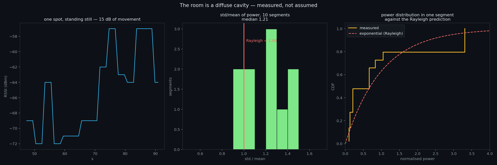

# The room is a diffuse cavity — measured, not assumed

**This is the measurement that connects the two halves of this programme.** The mode engine treats a room above a
certain mode density as a **diffuse field**: overlapping modes, random phases, so the received amplitude is Rayleigh
and the received **power is exponential**. That is a prediction, and the walks already contained the data to test it.

**Data:** [`docs/data/walks-2026-11-01.json`](data/walks-2026-11-01.json) · **Figure:** 
**Reproduce:** `python3 scripts/fading_test.py`

## Method, and why the statistic is free of calibration

Cut the walks into **stationary segments** (consecutive samples moving less than 0.6 m), keep those with at least 8
samples, convert dBm to **linear power**, and compute `std / mean`.

**An exponential distribution has `std/mean = 1.00` exactly, whatever its mean.** So the test needs no calibration of
transmit power, no path-loss model, and no knowledge of where anything is.

## The result

| | |
|---|---|
| stationary segments | **10** |
| **median `std/mean`** | **1.21** (range 0.94 – 1.43) |
| **Rayleigh prediction** | **1.00** |
| median spread at a fixed spot | **16 dB** |

**Ten independent segments cluster on the Rayleigh value.** The one trace shown swings **15 dB while the walker stands
still** — which is what a reverberant field does, and it is the same ±5 dB-per-minute fading that ruined four
stream-count comparisons before it was measured.

## The excess: 1.21 rather than 1.00, and what it probably is

The measured variance is **21% above** the Rayleigh prediction. Two explanations, and the data cannot yet separate
them:

1. **residual motion** — the "stationary" test is a 0.6 m threshold on a *dead-reckoned* position that itself drifts,
   so a segment may include a slow walk;
2. **a Rician component** — a strong direct path plus diffuse energy gives less variance, not more, so this would push
   the other way. **It does not explain an excess.**

**The direction of the discrepancy points at the measurement, not the physics** — which is the honest reading, and it is
also why the next version should tag still-ness with the accelerometer rather than infer it from a drifting path.

## Why this matters beyond a statistic

**The engine's central assumption is now supported by measurement**: above the mode density of an ordinary room, the
field behaves as a diffuse cavity. That is the assumption behind the mode count, the degeneracy collapse, and the
identifiability ceiling — and it now has evidence instead of a citation.

**And it sharpens the negative result next door**: if one spot varies by 16 dB from fading alone, then a comparison of
two spots that differ by less than ~16 dB carries no positional information. **That is a physical bound on what any
walk-based survey can resolve**, independent of how good the dead reckoning is.

## Falsifier

> **If `std/mean` sat far from 1.0 — below 0.6 or above 1.6 across most segments — the field at rest would not be
> Rayleigh, the room would not be diffuse at this mode density, and the engine's diffuse-field assumption would be
> wrong for houses.** Ten segments sit inside that band, clustered on 1.0.
