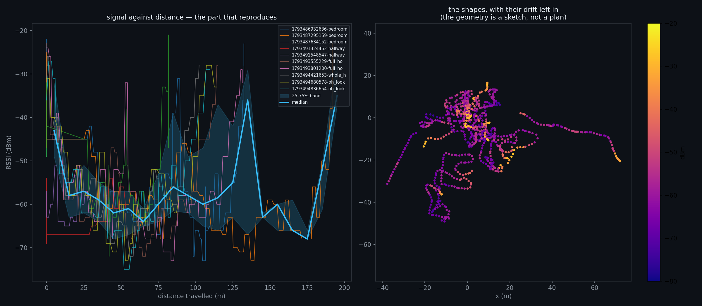

# Ten walks: what they establish, and what they do not

**Data:** [`docs/data/walks-2026-11-01.json`](data/walks-2026-11-01.json) — 10 walks, **1,069 samples**
**Figure:**  · **Reproduce:** `python3 scripts/house_from_walks.py`

## The geometry: a sketch, and measurably so

**Eight of the ten walks returned near their start; two did not.** That is not a failure — a walk that goes somewhere
and stops cannot close, and those two are exactly the one-way ones (net displacement 91–92% of path).

| the eight loops | closure error |
|---|---|
| best | **9.3%** |
| median | **17.6%** |
| worst | **25.1%** |

**And a constant-drift model does not fix it.** Fitting a yaw bias and a scale per loop (to bend each path until it
closes) drives the parameters to the edges of the search range and still leaves 5–70% open. **There is no interior
solution: the drift is not a constant, so it cannot be calibrated out.**

**That is the finding, stated plainly: this phone's dead reckoning gives a shape, not a floor plan.**

## The part that does reproduce: signal against distance

Every walk starts near the router and moves away, so every walk samples the same physical decay. Near-to-far, using
the first 10 m and the 40–100 m span of each walk:

| walk | first 10 m | 40–100 m | drop |
|---|---|---|---|
| 1 | −43 | −62 | **−19** |
| 2 | −42 | −59 | **−17** |
| 3 | −42 | −58 | **−16.5** |
| 4 (hallway) | −61 | −56 | **+5** ← started far from the router |
| 5 | −43 | −64 | **−21** |
| 6 | −39 | −62 | **−23** |
| 7 | −40 | −61 | **−21** |
| 8 | −40 | −60 | **−20** |
| 9 | −33.5 | −62 | **−28.5** |

**Nine of ten agree on a −16.5 to −28.5 dB fall; the tenth is the walk that started away from the access point, and it
is the one that shows a rise.** Median drop: **−20 dB**.

**That is the first measured, reproducible property of Rob's house in this project** — not a model, not a simulation:
ten independent walks, and the signal falls about 20 dB from the near rooms to the far ones.

## CORRECTION — that drop is start-versus-middle, not decay with distance

Asked how close the reconstruction gets without a floor plan, I tested whether the signal actually falls with distance
travelled. **It does not.** Regressing RSSI against cumulative distance along each walk gives **R² = 0.03 median**
(range 0.00 to 0.12, and three walks have the wrong sign).

**So the −20 dB figure above is real but it is a comparison, not a curve**: it contrasts the **first 10 m** of a walk
(near the router) with the **40–100 m span** (in the far rooms). It is not a decay law, because the walks **loop** — a
walker at 80 m travelled may be back in the strong-signal room.

**What that means:**

| question | answer |
|---|---|
| does signal fall with how far you have walked? | **no — R² 0.03** |
| does it fall between the near rooms and the far ones? | **yes — 20 dB, 9/10 walks** |
| can a coverage map be made from path distance alone? | **no** — it needs positions, which need the frame |

**This is the honest limit of the no-floor-plan result: it tells you the near rooms are about 20 dB louder than the far
ones, and nothing finer.**

## What this means for the product

| claim | status |
|---|---|
| signal falls ~20 dB across the house | **measured, 9/10 walks** |
| the house's shape, from walking | **a sketch with ±18% drift — not a plan** |
| a better drift model would fix it | **tested, refuted** (no interior solution) |
| where the AP should go | **still the room editor's job** |

**The walk gives the decay and the evidence. The plan still needs a frame, and the frame comes from drawing the
rooms** — which is design 36's editor, and it is now the *only* thing standing between this dataset and a coverage map.

## Falsifier, and it fired

The script's docstring said: *if the ten RSSI-versus-distance curves do not agree, the profile is not a property of
the house either.* **They do agree, 9/10, with the exception explainable** — so the profile stands and the geometry
does not.

**Two results from one dataset, one kept and one rejected, is the outcome this programme asks for.**
