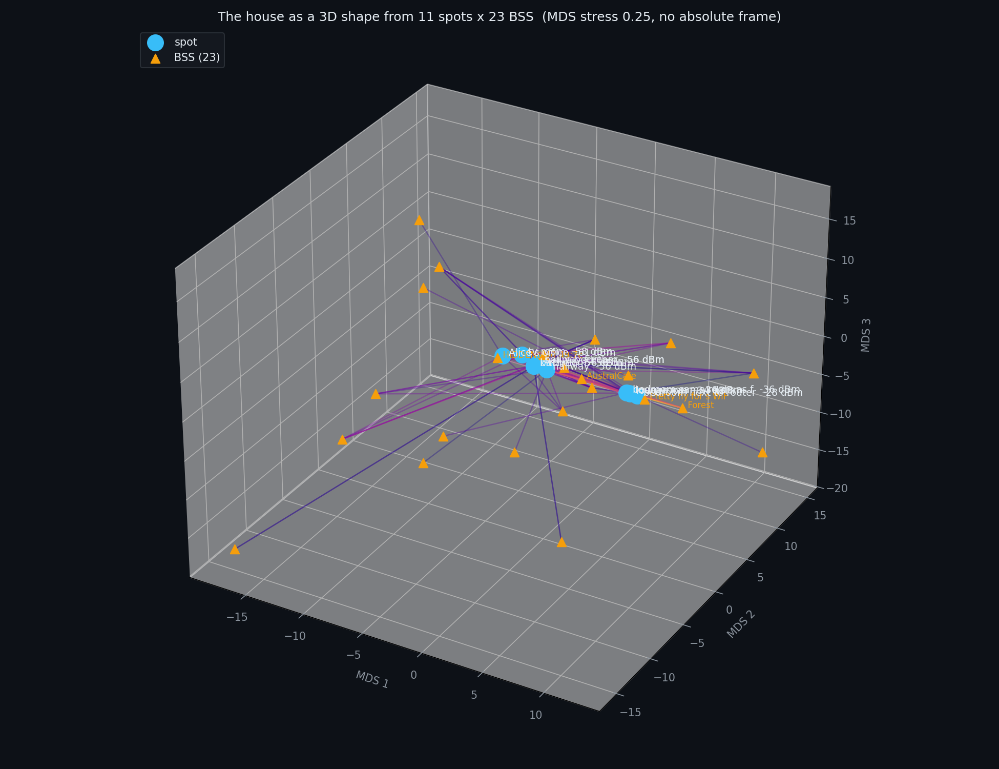
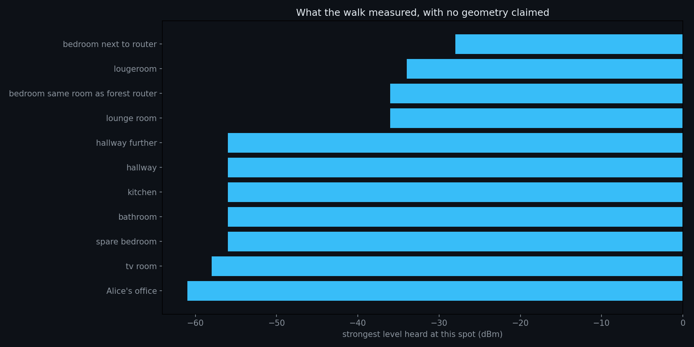

# The house as a 3D shape — what the walk actually determines

**Reproduce:** `python3 scripts/house_map.py` · **Data:** [`docs/data/house-walk-2026-10-31.csv`](data/house-walk-2026-10-31.csv)
**Figures:**  · 

Eleven labelled spots, twenty-three BSS, one walk with a phone. The question is how much **geometry** that contains.

## What is measured, and what is inferred

| | |
|---|---|
| **measured** | the level of every BSS at every spot — 3 dB quantised, ±5 dB fading (we saw 83→88→83 % at one spot in a minute) |
| **inferred** | the positions. **None of the spots has coordinates.** |

The positions come from two standard steps, and both are stated rather than assumed:

1. **spot layout** by classical MDS on RSSI-space distances — spots that hear the same BSS at similar levels land near
   each other. **Stress 0.246**, so a 3D shape explains the data reasonably.
2. **BSS positions** by a joint least-squares fit: attenuation relative to each AP's own best hearing, converted to
   distance through a log-distance model at **n = 2.7** (indoor, stated). **Residuals: rms 2.00 m, mean +0.78 m**
   over 33 measurable pairs.

## The honest part: this is a shape, not a floor plan

**RSSI carries no absolute frame.** The recovered configuration is correct up to **rotation, reflection and scale**,
and with eleven spots and twenty-three APs all at unknown positions, the free parameters outnumber the constraints.

**So the 3D figure is a blob, and it should look like one.** It tells you which rooms are *near* which in
signal-space. It does not tell you that the kitchen is east of the lounge. **Anyone showing you a tidy floor plan from
RSSI alone is drawing, not measuring.**

**The bar chart is the honest deliverable**: it claims no geometry at all, and it shows the one thing the walk
established beyond doubt —

| | |
|---|---|
| **bedroom next to router** | **−28 dBm** |
| loungeroom | −34 |
| bedroom (Forest room) | −36 |
| lounge room | −36 |
| hallway / hallway further / kitchen / bathroom | −56 |
| spare bedroom | −56 |
| tv room | −58 |
| **Alice's office** | **−61** |

**A 33 dB spread.** Everything past the hallway sits in a flat −56…−61 band — which is what a house looks like when one
AP covers it: strong nearby, then a floor set by the far walls.

## What would make it a floor plan

| need | why |
|---|---|
| **room positions** — a sketch, a floor plan, or eight numbers | the absolute frame; everything else is already measured |
| **repeated spots** — two or three scans per room | separates fading (±5 dB) from position change |
| **the same walk twice** | tells you whether the shape is stable or a one-off |

**That is exactly the room editor in design 36**: the user draws the rooms once, and the tool colours them with
measurements instead of inferring a layout from radio levels.

## Falsifier

> **If the same walk, repeated in a week, does not reproduce this shape, the map is a one-off and the method is not a
> product.** If it does reproduce, the shape is real and only the frame is missing.
