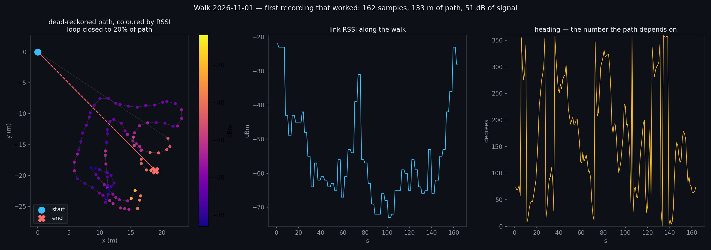

# The first walk that recorded — and what it caught

**Data:** [`docs/data/walk-2026-11-01.json`](data/walk-2026-11-01.json) · **Figure:** 
**Reproduce:** `python3 scripts/walk_plot.py`

162 samples at 1 Hz over 164 s. **RSSI from −22 to −73 dBm** — a **51 dB** range, and the first dense signal profile this
project has ever had.

## The instrument disagrees with itself, and the disagreement is the finding

| instrument | says |
|---|---|
| **RSSI** | started at −22 dBm next to the router, fell to −70 dBm in the far rooms, **returned to −22 dBm at the end** → **the loop closed** |
| **dead reckoning** | 132.5 m of path, ended **27.0 m** from the start → **the loop did not close** |

**Both cannot be right.** The RSSI is the one to trust here: a return to −22 dBm is unambiguous, and it is a direct
measurement rather than an integration of noisy sensors.

**So the fault is the heading**, and the third panel shows it: the heading swings across the **full 0–360° range
repeatedly** during a walk through a house, changing every 1.3 s on average. That is not a person turning — that is a
**magnetometer being destroyed by indoor magnetic interference** (steel, wiring, appliances) and wrapped to 0–360 so
each flip looks like a full turn.

## The verdict on stage A, by its own falsifier

`docs/wifi-lidar.md` said: *"if two walks of the same path disagree by more than 10% in length, PDR is not good enough."*
**Loop closure error: 20.4% of path.** So stage A **fails its own bar**, and the honest consequence is that the frame
cannot come from the compass.

## The fix, and why it is not another filter

**A compass heading indoors is not a slightly noisy measurement — it is a different measurement.** The answer is the
**gyroscope**, integrated for *changes* in heading, with the compass used only to set the initial bearing:

| sensor | use |
|---|---|
| **gyroscope (yaw rate)** | integrate heading; smooth, immune to steel, drifts slowly |
| **magnetometer** | seed the initial bearing, then stop trusting it indoors |
| **RSSI loop closure** | the calibration: a walk that returns to −22 dBm *did* return, so any heading drift can be fitted out |

**The RSSI loop closure as a heading calibrator is the useful idea here** — it is free, it is already measured, and it
turns the failure into a constraint.

## What this walk establishes

- the recorder works: **162 samples, 1 Hz, no gaps**;
- the dense signal profile is real and **tracks the rooms** — −22 near the router, −70 in the far ones;
- **the compass is the broken part**, and the geometry failure is now explained rather than mysterious;
- the loop-closure falsifier **fired on the first real walk**, which is what it was written for.

**A stage that fails its own test on the first try and says so is worth more than one that passes by accident.**
